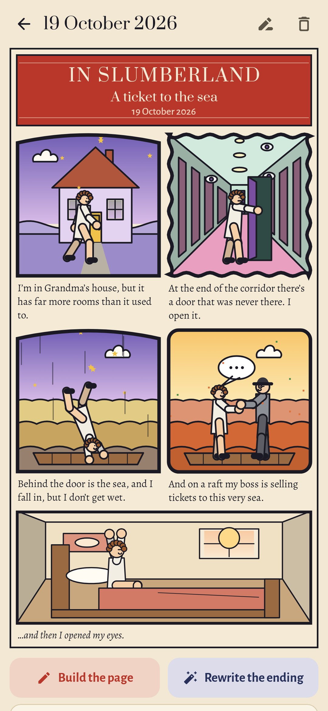
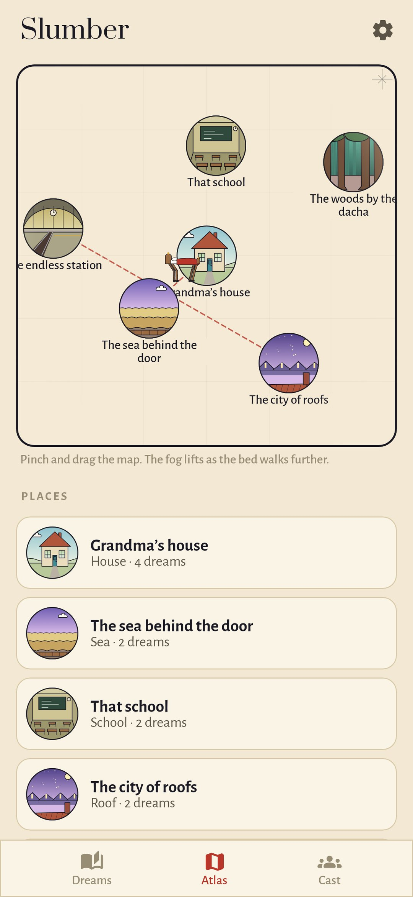

<p align="center"></p>

<h1 align="center">Slumber</h1>

<p align="center"><b>A dream journal that turns every dream into a Sunday comic page.</b><br>
In the spirit of Winsor McCay’s <i>Little Nemo in Slumberland</i> (1905–1914).</p>

<p align="center"><a href="README.ru.md">Читать по-русски</a></p>

<p align="center">
  
  
  
</p>

## How it works

1. **Tell it on waking.** The morning note or the widget opens a nearly black, dim screen with dark red letters, so you can tell the dream half asleep. Type it or say it aloud. If you pause too long, the words slowly pale, the way the dream does. They are never actually lost.
2. **It becomes a page.** The story is cut into panels at sentences, at “and then”, and at the middle of long run-on sentences. Each panel is a first guess built from four short lists:
   - **where**: 31 kinds of place;
   - **who**: you, your cast, or someone nameless;
   - **what happens**: 28 actions;
   - **how it felt**: 8 moods, which set the colours and the shape of the frame.

   Your own words go underneath. The last panel is always the same, as in Slumberland: you, awake in your own bed.
3. **Change anything with a tap.** If nothing in the lists fits, draw it on the panel with a finger. The app inks the drawing and fills in closed shapes.

## Your own dreamland

- **Atlas.** Name a place that keeps coming back (“Grandma’s house, but bigger”) and it goes on the map as a medallion. When a dream walks from one named place into another, a door appears between them.
- **Cast.** Build the people who return once, from a few choices: a person, animal, bird, living thing or creature; age, height, hair and clothes; something odd like no face, a glow or a double. They stay recognisable in every dream after. If a nameless figure gets the same label in two dreams, the app offers to add them to the cast.
- **Nemo’s bed.** The more mornings you remember a dream, the more the bed wakes up, grows legs and walks out across the atlas, and the fog lifts. A week with no dreams costs nothing: the bed just sleeps.

## A new ending

Give a dream a new ending with **Rewrite the ending**. This is imagery rehearsal, a well-studied way to loosen recurring nightmares.

- The new version becomes the page.
- The dream as it came stays on the back of the page, faded.
- In the evening, the app reminds you to read the new ending once before sleep.

Mark a **lucid dream** and a star goes on the banner.

## Private

There's no account, no internet permission and no tracking. Speaking a dream uses the phone's own speech recogniser. Every picture is drawn by the app in code.

## Build

```sh
./gradlew assembleDebug                 # app.slumber.dev
./gradlew assembleDebug -Pdemo          # app.slumber.demo with six weeks of dreams
./gradlew testDebugUnitTest             # tests
./gradlew testDebugUnitTest -Prender --tests '*RenderArtScreens*' && python tools/shots.py   # screenshots
python tools/icon.py                    # docs/logo.png
```

Kotlin, Jetpack Compose, Room, DataStore. Android 9+.

## License

MIT
