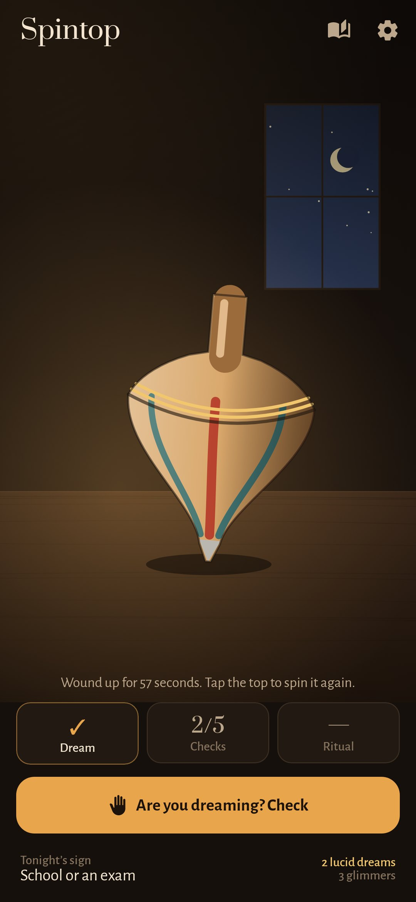
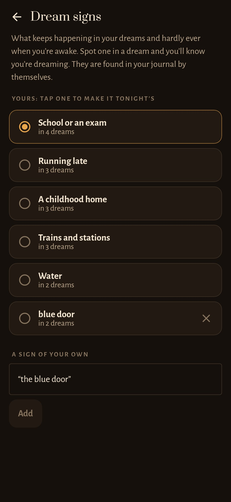
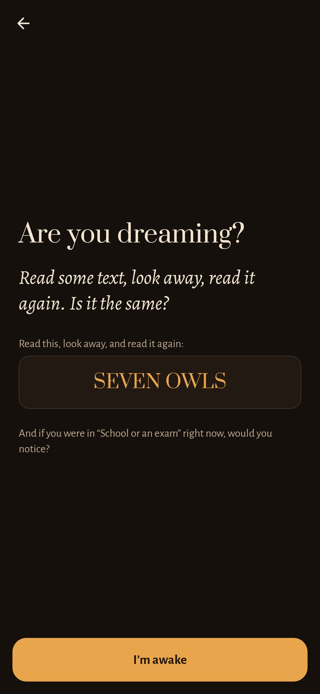
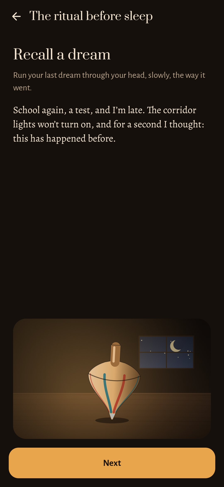

<div align="center">


# Spintop

### Notice that you're dreaming. In a dream, the top never falls.

*Lucid dreaming isn't a gift, it's a habit: asking "am I dreaming?" often enough that you ask it in your sleep too. Spintop builds that habit in three small moments a day. In the morning you tell your dream in the dark; in the day a few quiet checks ask whether you're dreaming; at night it's two minutes with the top and an intention. A wooden top on a lamplit desk keeps count: the more you practise, the longer it spins. Free, no ads, no account, no internet.*

[](https://github.com/bigdevwhale/slumber/actions/workflows/android.yml)
[](https://github.com/bigdevwhale/slumber/releases/latest)


[](LICENSE)

**English** · [Русский](README.ru.md) · [Website](https://bigdevwhale.github.io/stillcraft/apps/spintop/) · [Changelog](CHANGELOG.md)

   

**[⬇ Download Spintop.apk](https://github.com/bigdevwhale/slumber/releases/latest/download/Spintop.apk)**

</div>

---

## The idea

In *Inception*, a spinning top tells a dream from waking life: in a dream it never falls. Real lucid dreamers use the same trick in other forms. They look for **dream signs**, the things that only happen in their dreams, and they ask **"am I dreaming?"** so often during the day that the question turns up at night too. The research behind it is simple: keep a dream journal, do reality checks, and fall asleep intending to notice. Spintop puts all three into one small, quiet routine. There are no lists to fill in and no pictures to pick. You tell, check and spin, and the app does the rest.

## A day with the top

| | When | What you do | Why it helps |
|---|---|---|---|
| 🌅 | **Morning** | Tell the dream on a dim red screen, typed or aloud, then say how clear it was: *no*, *a glimmer*, *yes*. | You can only become lucid in dreams you remember, and remembering grows with telling. |
| ✋ | **Day** | A few times, at moments you can't guess: *"Are you dreaming?"* with one check. Tap **Checked**. | The question becomes a habit and starts to turn up inside dreams. |
| 🕯️ | **Night** | Two minutes of MILD: recall a dream, look at tonight's sign, hold the top while you repeat the intention. | You fall asleep expecting to notice, which is how most lucid dreams begin. |

## What's inside

- **Telling it in the dark.** The morning note or the home-screen widget opens a nearly black screen with dim red letters, and the screen brightness drops to almost nothing. Fragments are fine. Pause too long and the words pale, the way a dream does. They never actually go, and one keystroke brings them back. A draft survives if the phone is put down.
- **Dream signs, found by themselves.** 21 common signs are recognised in Russian and English, among them school and exams, running late, flying, lights that won't turn on, a phone that won't work, text that changes, extra rooms, a childhood home, water, being chased and teeth. A sign becomes *yours* once it shows up in two dreams. Add your own in your own words, such as "the blue door"; any word form matches.
- **Reality checks.** Eight checks that dreams get wrong: count your fingers, read a line twice, pinch your nose and breathe, look at a clock twice, flip a switch, push a finger into your palm, jump, and remember how this hour began. They arrive at random moments inside a window you choose, three to ten a day, never in a bunch. The check screen gives you a line to read, look away from and read again, plus a question about tonight's sign.
- **The ritual before sleep.** Recall the last dream, see tonight's sign, then press and hold the top for twenty seconds while a ring of lamplight fills and you repeat *"Next time 'school or an exam' happens, I'll notice I'm dreaming."* Then the lamp goes down.
- **The top keeps count.** Its wind-up comes from the last seven days: dreams remembered, checks, rituals, and above all glimmers and lucid dreams. It spins from five seconds to over a minute, slowing, wobbling wider and finally falling onto its side. A missed day loosens it a little and nothing more. Each lucid dream adds a brass ring round its shoulder, and the morning after one it glows and doesn't fall all day.
- **Quiet by design.** The palette is dark walnut and one warm lamp, dim enough to open in bed. Notes are silent except the soft buzz of a check, and each is skipped when it's already been done.

## Privacy

Everything stays on the phone. There's no account, no ads, no analytics and no internet permission at all. Telling a dream aloud uses the phone's own speech recogniser. Permissions are limited to notifications and vibration.

## Install

1. Download [Spintop.apk](https://github.com/bigdevwhale/slumber/releases/latest/download/Spintop.apk) on your phone.
2. Open it and allow installs from this source when Android asks.
3. Pick when you go to bed and when you wake, and spin the top.

On Xiaomi/HyperOS and other strict battery savers, allow autostart, or the notes may not arrive (Settings → *Let notes through*).

## Build from source

Requires JDK 17+ (Android Studio's bundled JBR works) and the Android SDK.

```sh
git clone https://github.com/bigdevwhale/slumber.git
cd slumber
./gradlew testDebugUnitTest             # signs, the wind-up, the top's spin, the check plan
./gradlew assembleDebug                 # app.slumber.dev, installs next to a release
./gradlew assembleDebug -Pdemo          # app.slumber.demo with three weeks of practice
./gradlew testDebugUnitTest -Prender --tests '*RenderArtScreens*' && python tools/shots.py   # screenshots
python tools/icon.py                    # docs/logo.png
```

Kotlin, Jetpack Compose, Room and DataStore. The desk, the lamp, the window and the spinning top are all drawn in code.

| Where | What |
|---|---|
| `domain/Signs.kt` | Dream signs and their word stems; the reality checks |
| `domain/Spin.kt` | Clarity, the week's practice, the wind-up |
| `domain/Plan.kt` | When the checks come: random moments in even slots, the same after a reboot |
| `notify/Notes.kt` | The morning, check and bedtime notes |
| `ui/art/Top.kt`, `SpinningTop.kt` | The desk and the top, and how it spins, wobbles and falls |

## License

[MIT](LICENSE). Part of [Stillcraft](https://bigdevwhale.github.io/stillcraft/), small free apps for everyday life.
