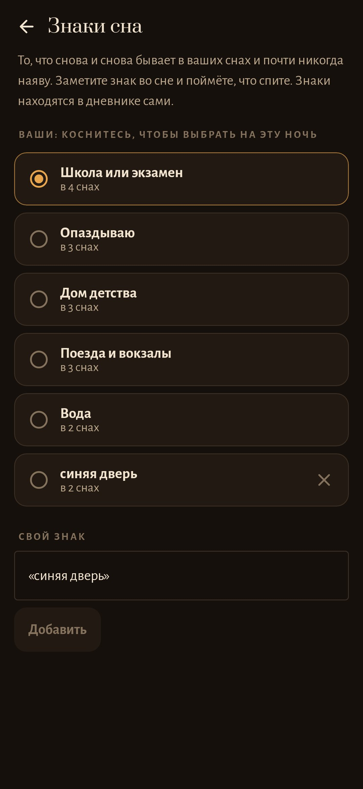
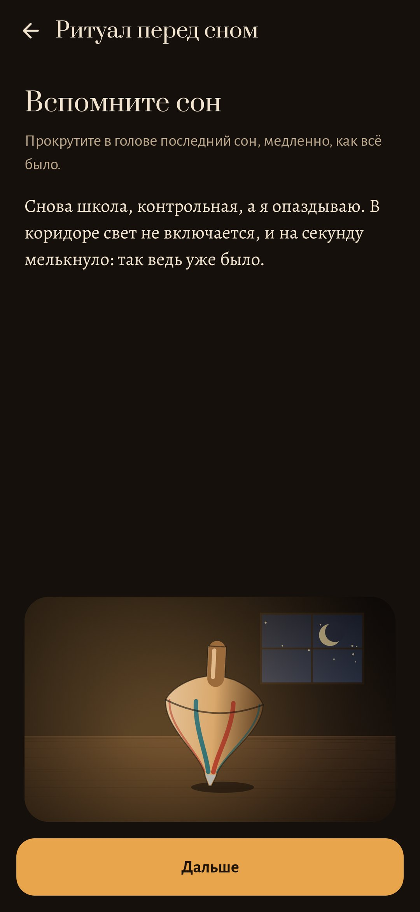

<p align="center"></p>

<h1 align="center">Волчок</h1>

<p align="center"><b>Уютный тренажёр осознанных снов. Во сне волчок не падает.</b></p>

<p align="center"><a href="README.md">Read in English</a></p>

<p align="center">
  
  
  
</p>

«Волчок» учит замечать во сне, что вы спите. Практика состоит из трёх частей, а волчок ведёт им счёт.

## Утро: рассказать сон

Утреннее уведомление или виджет открывают тёмный тусклый экран с красными буквами, чтобы можно было рассказывать в полусне.

- Сон можно напечатать или надиктовать.
- Если надолго замолчать, слова медленно бледнеют, как сам сон. На самом деле ничего не пропадает.
- Потом один вопрос: *во сне было ясно, что это сон?* Варианты ответа: нет, мелькнуло, да.

## Знаки сна

Приложение само находит в дневнике ваши **знаки сна**. Это то, что снова и снова бывает во снах и почти никогда наяву: школа и экзамены, опоздания, свет, который не включается, дом детства, вода. Ничего размечать не нужно. Можно добавить и свой знак, например «синяя дверь».

## День: проверки реальности

Несколько раз в день, в моменты, которые не угадать, приходит тихое **«Ты спишь?»**.

- В каждом уведомлении одна проверка, которая работает потому, что во сне она даёт сбой: сосчитать пальцы, дважды прочитать надпись, зажать нос и попробовать вдохнуть.
- Отметить её можно кнопкой **«Проверено»** прямо в уведомлении.
- Привычка спрашивать себя переходит в сон.

## Ночь: ритуал

Две минуты перед сном, по методу MILD — самому изученному способу войти в осознанный сон:

1. Вспомнить последний сон.
2. Посмотреть на знак этой ночи.
3. Держать волчок, пока он крутится, и повторять про себя: *«Когда снова будет „Школа или экзамен“, я замечу, что сплю».*

## Волчок

Волчок стоит на ореховом столе под лампой.

- Чем больше практики, тем дольше он крутится. Считаются записанные сны, проверки, ритуалы и прежде всего проблески и осознанные сны.
- Пропущенные дни лишь немного его ослабляют.
- Каждый осознанный сон добавляет латунное кольцо.
- Наутро после осознанного сна волчок светится и весь день не падает.

## Приватность

Без аккаунта, без разрешения на интернет, без слежки. Для рассказа вслух используется распознавание речи самого телефона. Все картинки приложение рисует кодом.

## Сборка

```sh
./gradlew assembleDebug                 # app.slumber.dev
./gradlew assembleDebug -Pdemo          # app.slumber.demo с тремя неделями практики
./gradlew testDebugUnitTest             # тесты
./gradlew testDebugUnitTest -Prender --tests '*RenderArtScreens*' && python tools/shots.py   # скриншоты
python tools/icon.py                    # docs/logo.png
```

Kotlin, Jetpack Compose, Room, DataStore. Android 9+.

## Лицензия

MIT
