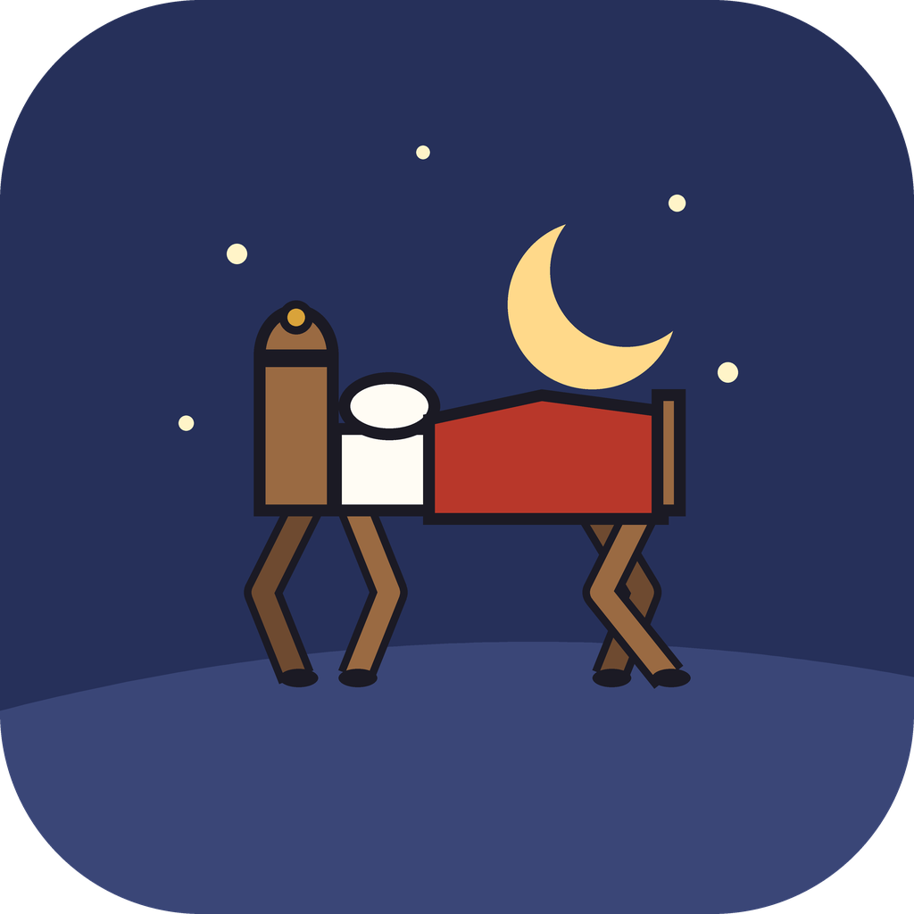
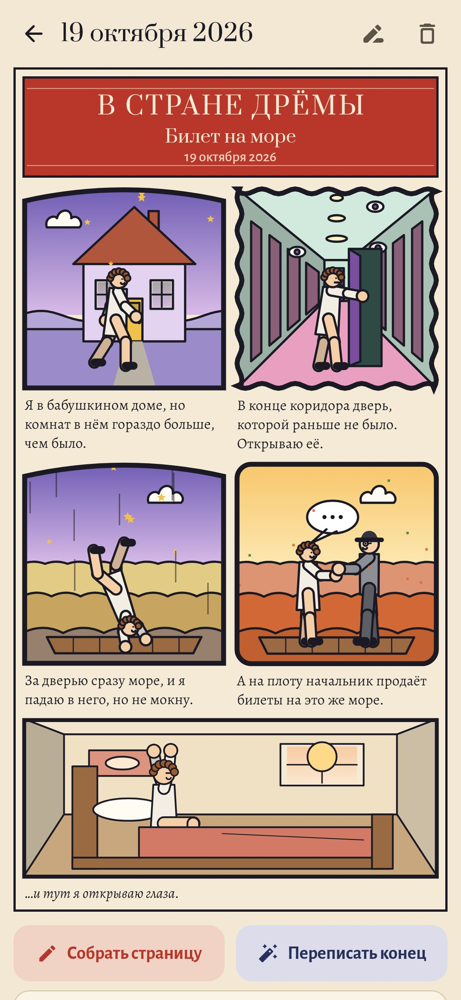
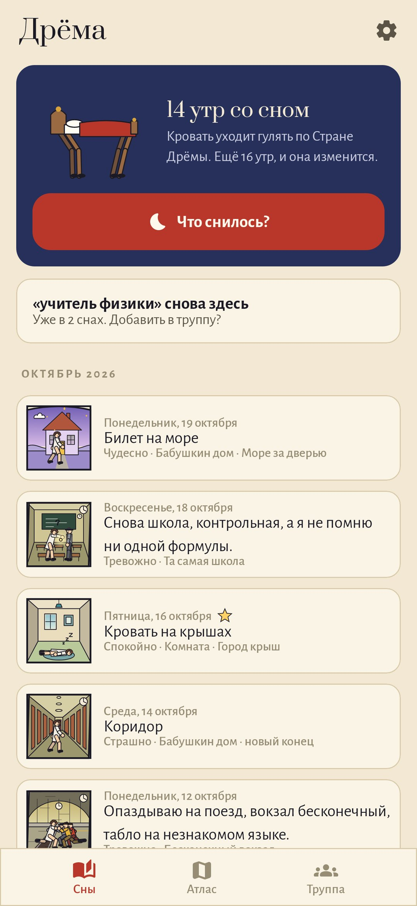
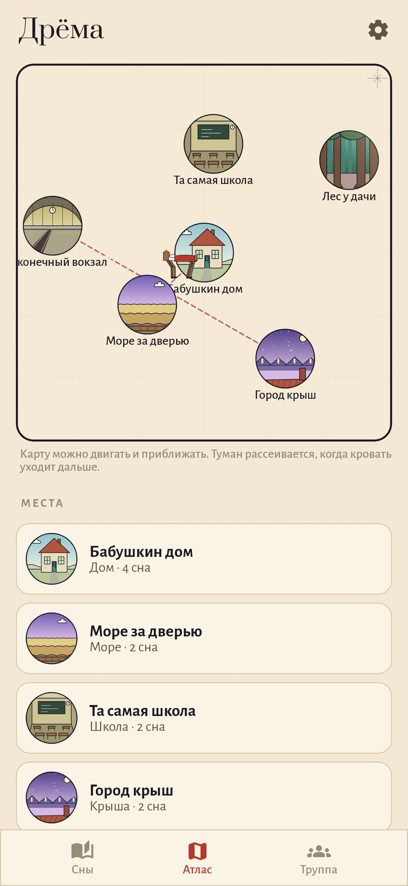

<p align="center"></p>

<h1 align="center">Дрёма</h1>

<p align="center"><b>Дневник снов, где каждый сон становится воскресной комикс-страницей.</b><br>
В духе «Малыша Немо в Стране Снов» Уинзора Маккея (1905–1914).</p>

<p align="center"><a href="README.md">Read in English</a></p>

<p align="center">
  
  
  
</p>

## Как это работает

1. **Рассказать сразу после пробуждения.** Утреннее уведомление или виджет открывают почти чёрный тусклый экран с тёмно-красными буквами: можно рассказывать в полусне. Сон можно напечатать или надиктовать. Если надолго замолчать, слова медленно бледнеют, как сам сон. На самом деле ничего не пропадает.
2. **Из рассказа получается страница.** Текст режется на кадры по предложениям, по «и тут», «а потом» и посередине длинных сбивчивых фраз. Для каждого кадра приложение само делает первую догадку из четырёх коротких списков:
   - **где**: 31 вид места;
   - **кто**: вы, ваша труппа или кто-то безымянный;
   - **что происходит**: 28 действий;
   - **как ощущалось**: 8 настроений, они задают цвет и форму рамки.

   Под кадрами идут ваши слова. Последний кадр всегда один, как у Маккея: вы проснулись в своей кровати.
3. **Всё меняется одним касанием.** Если в списках нет нужного, это можно нарисовать пальцем прямо в кадре. Приложение обведёт рисунок тушью, а замкнутые фигуры закрасит.

## Своя Страна Дрёмы

- **Атлас.** Назовите место, которое снится снова и снова («Бабушкин дом, но больше»), и оно появится на карте медальоном. Если сон переходит из одного названного места в другое, между ними появляется дверь.
- **Труппа.** Тех, кто возвращается, вы собираете один раз из нескольких вариантов: человек, зверь, птица, ожившая вещь или существо; возраст, рост, волосы, одежда; что-то странное вроде «без лица», «светится» или «двоится». Дальше персонаж узнаётся в любом сне. Если безымянного в двух снах подписать одинаково, приложение предложит взять его в труппу.
- **Кровать Немо.** Чем больше утр со вспомненным сном, тем больше кровать просыпается: отращивает ноги, уходит гулять по атласу, а туман на карте рассеивается. Неделя без снов ничего не отнимает, кровать просто спит.

## Новый конец

Кнопка **«Переписать конец»** даёт сну новое окончание. Это imagery rehearsal, хорошо изученный способ ослабить повторяющиеся кошмары.

- Новая версия становится страницей.
- Сон, каким он приснился, остаётся бледной изнанкой страницы.
- Вечером приложение напоминает перечитать новый конец перед сном.

Если отметить **осознанный сон**, на шапке страницы появится звезда.

## Приватность

Без аккаунта, без разрешения на интернет, без слежки. Для рассказа вслух используется распознавание речи самого телефона. Все картинки приложение рисует кодом.

## Сборка

```sh
./gradlew assembleDebug                 # app.slumber.dev
./gradlew assembleDebug -Pdemo          # app.slumber.demo с шестью неделями снов
./gradlew testDebugUnitTest             # тесты
./gradlew testDebugUnitTest -Prender --tests '*RenderArtScreens*' && python tools/shots.py   # скриншоты
python tools/icon.py                    # docs/logo.png
```

Kotlin, Jetpack Compose, Room, DataStore. Android 9+.

## Лицензия

MIT
