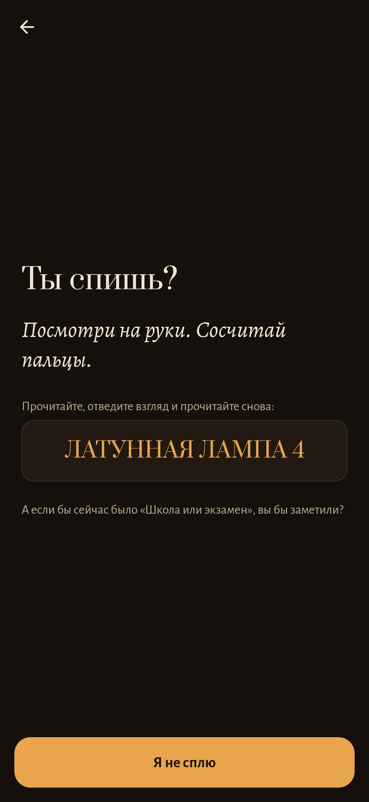

<div align="center">


# Волчок

### Заметить, что спишь. Во сне волчок не падает.

*Осознанный сон — не дар, а привычка: спрашивать себя «а не сплю ли я?» так часто, что вопрос приходит и во сне. «Волчок» вырабатывает её в три коротких момента в день. Утром вы рассказываете сон в темноте, днём несколько тихих проверок спрашивают, не спите ли вы, ночью две минуты с волчком и намерением. Деревянный волчок на столе под лампой ведёт счёт: чем больше практики, тем дольше он крутится. Бесплатно, без рекламы, аккаунта и интернета.*

[](https://github.com/bigdevwhale/slumber/actions/workflows/android.yml)
[](https://github.com/bigdevwhale/slumber/releases/latest)


[](LICENSE)

[English](README.md) · **Русский** · [Сайт](https://bigdevwhale.github.io/stillcraft/apps/spintop/) · [Изменения](CHANGELOG.md)

   

**[⬇ Скачать Spintop.apk](https://github.com/bigdevwhale/slumber/releases/latest/download/Spintop.apk)**

</div>

---

## Идея

В «Начале» волчок отличает сон от яви: во сне он никогда не падает. Те, кто видит осознанные сны, пользуются тем же приёмом в других формах. Они ищут **знаки сна** — то, что бывает только в их снах, — и днём так часто спрашивают себя **«а не сплю ли я?»**, что вопрос приходит и ночью. Исследования здесь простые: вести дневник снов, делать проверки реальности и засыпать с намерением заметить. «Волчок» собирает всё это в одну короткую тихую привычку. Ни списков для заполнения, ни картинок на выбор: вы рассказываете, проверяете и крутите волчок, остальное приложение делает само.

## День с волчком

| | Когда | Что вы делаете | Зачем |
|---|---|---|---|
| 🌅 | **Утро** | Рассказываете сон на тусклом красном экране, текстом или вслух, и отмечаете, насколько было ясно: *нет*, *мелькнуло*, *да*. | Осознать можно только сон, который помнишь, а вспоминать помогает привычка рассказывать. |
| ✋ | **День** | Несколько раз, в моменты, которые не угадать: *«Ты спишь?»* и одна проверка. Касание — **«Проверено»**. | Вопрос становится привычкой и начинает приходить во сне. |
| 🕯️ | **Ночь** | Две минуты по MILD: вспомнить сон, посмотреть на знак этой ночи, держать волчок и повторять намерение. | Вы засыпаете с ожиданием заметить — с этого начинается большинство осознанных снов. |

## Что внутри

- **Рассказать в темноте.** Утреннее уведомление или виджет на главном экране открывают почти чёрный экран с тусклыми красными буквами, и яркость падает почти до нуля. Можно обрывками. Если надолго замолчать, слова бледнеют, как сам сон. На самом деле они не пропадают, одна буква возвращает их. Черновик сохраняется, даже если телефон отложить.
- **Знаки сна находятся сами.** Приложение узнаёт 21 частый знак на русском и английском: школу и экзамены, опоздания, полёт, свет, который не включается, телефон, который не слушается, текст, который меняется, лишние комнаты, дом детства, воду, погоню, зубы. Знак становится *вашим*, когда встречается хотя бы в двух снах. Можно добавить свой, например «синяя дверь», — любая форма слова подойдёт.
- **Проверки реальности.** Восемь проверок, на которых сон ошибается: сосчитать пальцы, дважды прочитать строку, зажать нос и вдохнуть, дважды посмотреть на часы, щёлкнуть выключателем, надавить пальцем на ладонь, подпрыгнуть, вспомнить, как начался этот час. Они приходят в случайные моменты в выбранные вами часы, от трёх до десяти в день, и никогда пачкой. На экране проверки — строка, чтобы прочитать, отвести взгляд и прочитать снова, и вопрос про знак этой ночи.
- **Ритуал перед сном.** Вспомнить последний сон, увидеть знак этой ночи, потом нажать и двадцать секунд держать волчок. Пока заполняется кольцо света, повторяете *«Когда снова будет „Школа или экзамен“, я замечу, что сплю»*. Потом лампа гаснет.
- **Волчок ведёт счёт.** Его закрутка собирается за последние семь дней: записанные сны, проверки, ритуалы и прежде всего проблески и осознанные сны. Он крутится от пяти секунд до минуты с лишним: замедляется, раскачивается всё шире и наконец ложится на бок. Пропущенный день лишь немного его ослабляет. Каждый осознанный сон добавляет латунное кольцо на плечо волчка, а наутро после такого сна он светится и весь день не падает.
- **Тихий по задумке.** Тёмный орех и одна тёплая лампа, достаточно тусклые, чтобы открывать в постели. Уведомления беззвучные, кроме лёгкой вибрации проверки, и не приходят, если дело уже сделано.

## Приватность

Всё остаётся на телефоне. Без аккаунта, рекламы, аналитики и вообще без разрешения на интернет. Для рассказа вслух используется распознавание речи самого телефона. Разрешения: только уведомления и вибрация.

## Установка

1. Скачайте [Spintop.apk](https://github.com/bigdevwhale/slumber/releases/latest/download/Spintop.apk) на телефон.
2. Откройте файл и разрешите установку из этого источника, когда Android спросит.
3. Выберите, когда ложитесь и просыпаетесь, и закрутите волчок.

На Xiaomi/HyperOS и других телефонах со строгой экономией батареи разрешите автозапуск, иначе уведомления могут не приходить (Настройки → «Пропускать уведомления»).

## Сборка из исходников

Нужны JDK 17+ (подойдёт JBR из Android Studio) и Android SDK.

```sh
git clone https://github.com/bigdevwhale/slumber.git
cd slumber
./gradlew testDebugUnitTest             # знаки, закрутка, вращение волчка, план проверок
./gradlew assembleDebug                 # app.slumber.dev, ставится рядом с релизом
./gradlew assembleDebug -Pdemo          # app.slumber.demo с тремя неделями практики
./gradlew testDebugUnitTest -Prender --tests '*RenderArtScreens*' && python tools/shots.py   # скриншоты
python tools/icon.py                    # docs/logo.png
```

Kotlin, Jetpack Compose, Room, DataStore. Стол, лампа, окно и волчок нарисованы кодом.

## Лицензия

[MIT](LICENSE). Часть [Stillcraft](https://bigdevwhale.github.io/stillcraft/) — маленьких бесплатных приложений для обычной жизни.
